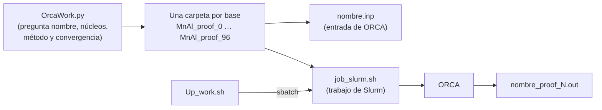

# Modulos_Orca

Scripts para preparar y lanzar en un clúster con Slurm un barrido de simulaciones de ORCA 4.2.1: la misma celda de MnAl (10 átomos de Mn y 4 de Al) calculada con cada una de las 97 bases de la lista.



## Qué hace cada archivo

| Archivo | Para qué sirve |
|---|---|
| `OrcaWork.py` | Crea, para cada base, una carpeta con la entrada de ORCA y su trabajo de Slurm |
| `Up_work.sh` | Trabajo de Slurm que envía a la cola (`sbatch`) un rango de esas carpetas |

Cada entrada de ORCA pide una optimización de geometría con frecuencias numéricas (`Opt NumFreq`) usando el método, la convergencia y la base indicados.

## Cómo usarlo

Requiere Python 3. No necesita instalar nada.

```bash
python OrcaWork.py
```

El script pregunta el nombre del trabajo, los núcleos totales y por nodo, la partición de Slurm, el método (HF, B3LYP…) y la convergencia. Con eso genera:

```text
<destino>/<nombre>/MnAl_<año>_<mes>_<día>/
├── MnAl_proof_0/
│   ├── job_slurm.sh
│   └── <nombre>.inp
├── MnAl_proof_1/
│   └── …
└── MnAl_proof_96/
```

El número de cada carpeta es la posición de su base en la lista `Bases` del script.

Por defecto usa las rutas del servidor donde se desarrolló. Para otro equipo:

```bash
python OrcaWork.py --destino /ruta/de/simulaciones/ --orca /ruta/a/orca
```

Para enviar los trabajos, ajusta en `Up_work.sh` la ruta y el rango de carpetas (hoy, de la 30 a la 50) y ejecútalo con `sbatch Up_work.sh`.

## Pruebas

```bash
pip install pytest
pytest
```

Las pruebas comparan los archivos generados con los que producía la versión original del script (`tests/golden`) y comprueban que cada base tenga su carpeta.

## Límites

- La geometría de la celda y las palabras clave de ORCA están escritas en el código; para otro sistema hay que editarlas.
- `Up_work.sh` tiene la ruta y el rango de carpetas fijos.
- Los trabajos generados envían los avisos de Slurm al correo que está escrito en el script.
- En esta revisión se comprobó que los archivos se generan igual que antes; no se ejecutaron contra ORCA ni contra Slurm.

## Licencia

Ver [LICENSE](LICENSE).
